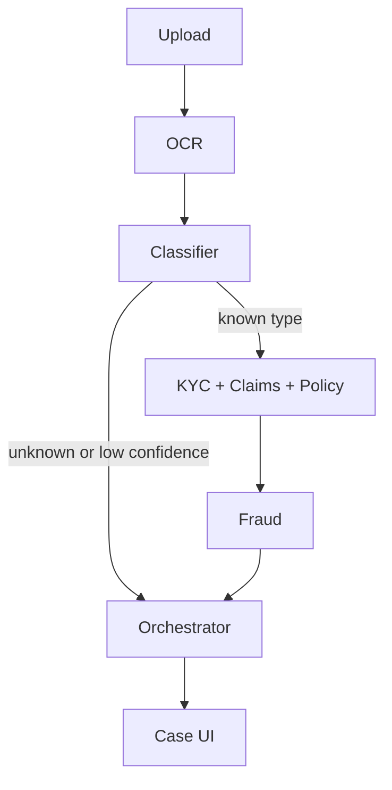

# Medi-Shield

One uploaded document becomes a case. A LangGraph pipeline classifies it, checks identity, extracts claim fields, looks up the policy, scores fraud, and returns Approve, Reject, or Escalate. Operations staff review escalated cases in the web app.

## Open the app

Two processes have to be running. Use two terminals from this folder.

**Terminal 1 — API**

```bash
cd backend
python3 -m venv .venv
source .venv/bin/activate
pip install -r requirements.txt
cd ..
backend/.venv/bin/uvicorn app.main:app --reload --host 127.0.0.1 --port 8000 --app-dir backend
```

**Terminal 2 — case UI**

```bash
cd frontend
npm install
npm run dev
```

Then open:

| Page | URL | What you should see |
|---|---|---|
| Case list | http://127.0.0.1:3000 | A table of cases with status and decision badges |
| Case detail | http://127.0.0.1:3000/cases/case_b340a851114a | The document, the decision, each agent's output, the override form, and the audit log |
| Review queue | http://127.0.0.1:3000/review | Escalated cases only. Empty after an override |
| API docs | http://127.0.0.1:8000/docs | Upload a JPEG, PNG, PDF, or TIFF with `POST /cases` |
| Health | http://127.0.0.1:8000/health | `{"status":"ok","env":"local","classifier":"local"}` |

Upload from the API docs page: open `POST /cases`, choose **Try it out**, attach a file from `data/dataset/`, and execute. Copy the `case_id`. The case list at http://127.0.0.1:3000 shows it after a refresh. Open the case, read the decision, and use **Save override** to change it. The audit log records the change, and a case that is no longer escalated leaves the review queue.

A sample case is already loaded: `case_b340a851114a` (a bank statement, escalated by the pipeline, then rejected by a reviewer).

## Prerequisites

- Python 3.11+
- Node.js 20+
- Tesseract OCR. On macOS: `brew install tesseract`. The API looks for `/opt/homebrew/bin/tesseract` and `/usr/local/bin/tesseract`.

Copy `.env.example` to `.env` if you want to override the host, port, storage directory, or database URL. No API key is required. The pipeline reads the page with Tesseract.

## Groq vision classifier

Leave `GROQ_API_KEY` empty and the classifier stays local. To use Groq instead, create a key at https://console.groq.com/keys and put it in `.env`:

```bash
GROQ_API_KEY=gsk_your_key_here
GROQ_MODEL=meta-llama/llama-4-scout-17b-16e-instruct
```

Restart the API. http://127.0.0.1:8000/health then shows `"classifier":"groq"`. Each new upload sends the page image to that model. If Groq is unreachable, that case falls back to the local classifier. The key is read from the environment only and is not written into case records.

## Regenerate the documents

The images are gitignored. Gold labels and the two policy PDFs are in the repo. To rebuild everything:

```bash
backend/.venv/bin/python -m pip install -r tools/datagen/requirements.txt
backend/.venv/bin/python tools/build_dataset.py
```

That writes `data/dataset/` (155 PNGs), `data/policies/` (Gold and Silver), and `data/gold/gold.json`.

## Score the 20-document set

```bash
export PATH="/opt/homebrew/bin:$PATH"
backend/.venv/bin/python tools/evaluate.py
```

Latest result on the fixed 20-file set in `tools/evaluate.py`:

| Criterion | Weight | Result |
|---|---|---|
| Classification | 20% | 100% |
| Extraction | 20% | 90% |
| Policy retrieval | 15% | 100% |
| Decision | 25% | 90% |
| UI | 10% | Case list, detail, override, and review queue checked in the browser |
| Structure | 10% | One module per agent, typed agent outputs, no credentials in source |
| **Weighted** | | **95.5%** |

Decision correctness is above the 60% bar. Two files still miss, and both are visual rather than textual: the tampered driver's license only shifts the expiry glyphs, and the name-mismatch license (`Sindra` vs `Sandra`) is read by OCR as the member's real name.

## How a case is decided



1. Unknown document, or classifier confidence under 0.6 → **Escalate**
2. Fraud score at least 0.3 → **Escalate**
3. KYC failed, claim schema invalid, or procedure not covered → **Reject**
4. Otherwise → **Approve**

Policy lookup reads the Gold and Silver PDFs, chunks each page, and matches procedure codes to the exclusion ranges in section 4.1. A code outside those ranges is covered at 80% (20% coinsurance after the deductible). Member identity and prior claim numbers come from `data/gold/gold.json`.

## Layout

```
backend/app/           FastAPI cases, SQLite, LangGraph pipeline
frontend/              Next.js case list, detail, review queue
data/dataset/          Synthetic documents (gitignored)
data/policies/         Gold and Silver PDFs
data/gold/gold.json    Field-level labels and expected decisions
data/gold/scorecard.json
tools/evaluate.py      20-document score
```

## Sprints

| Sprint | Status |
|---|---|
| 1. Foundation | Verified. `GET /health` |
| 2. Dataset and gold labels | Verified. 155 documents, `data/gold/gold.json` |
| 3. Ingestion | Verified. Upload, `case_id`, file stored under `data/raw/` |
| 4. Classifier | Verified. 20/20 types on the score set |
| 5. Claims extraction | Verified. 90% of ICD, CPT, NPI, amount, and service date |
| 6. KYC | Verified. Expired IDs reject. Expiring-soon IDs approve |
| 7. Policy retrieval | Verified. Excluded CPTs cite section 4.1. Covered CPTs cite coinsurance |
| 8. Decision pipeline | Verified. 90% of gold decisions |
| 9. Case UI | Verified in the browser |
| 10. Evaluation | Verified. Weighted score 95.5%, decision correctness 90% |
